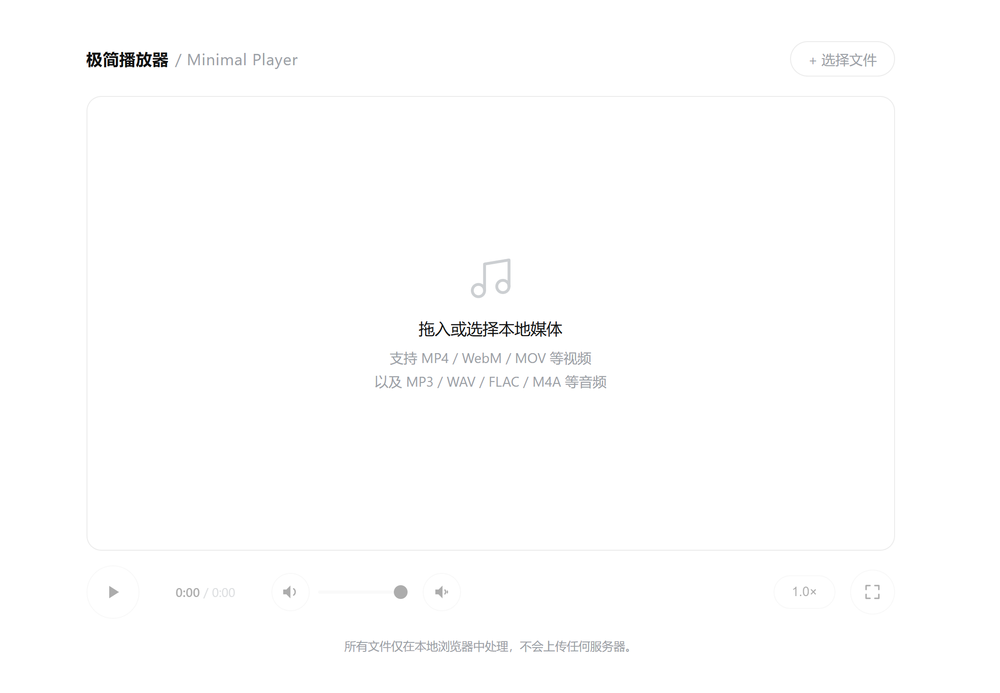

[English](README.md) | [简体中文](README_Simplified_Chinese.md) | [繁體中文](README_Classical_Chinese.md)

# Minimal Player

> A single-file, zero-dependency, fully local web audio & video player. All decoding and playback happen inside the browser — **nothing is ever uploaded**.

## Quick Start

1. Open `index.html` directly in a browser (just double-click it — no server, no build step, no network required).
2. **Drag audio/video files into the play area**, or click "+ Choose File" in the top-right corner.
3. Play/pause: click the play button, or click on the video surface.

> Files are only loaded when dropped onto the **play area**. Dropping them anywhere else on the page does nothing — and it won't let the browser open the file directly and replace the page either.

## Features at a Glance

| Feature | Description |
| --- | --- |
| Play / Pause | Play button or click the video surface; the icon has a subtle scale feedback |
| Waveform + Seek | Shows the audio waveform and playback progress; **click anywhere on the waveform to seek** (the waveform bar is the only progress bar on the page) |
| Real-time Spectrum | Audio files show a real-time bar spectrum in the play area; falls back to a static low-amplitude waveform when paused/idle |
| Playback Speed | 0.5× / 0.75× / 1.0× / 1.25× / 1.5× / 2.0× / 3.0×, persists across file changes |
| Volume / Mute | Volume 0–1; muting collapses the volume slider and boost group, clicking the speaker restores them |
| Volume Boost | 1.0×–10.0× gain, followed by a peak limiter (can be disabled independently) |
| Fullscreen | Enlarges the play area to fullscreen, press Esc to exit |
| Drag & Drop Loading | Drop onto the play area to load, with a dashed highlight feedback |

## Supported Formats

- **Video**: MP4 / M4V / WebM / MOV / MKV / AVI / FLV / WMV / MPEG / TS / 3GP / OGV / RMVB / VOB
- **Audio**: MP3 / WAV / FLAC / M4A / AAC / OGG / OPUS / WMA / AIFF / ALAC / APE

> Whether a file ultimately plays depends on the **browser's** decoding capability. Containers such as MKV / AVI / RMVB in the list above usually can't be decoded by Chrome / Edge — in that case a clear message is shown rather than leaving you with a black screen.

## Implementation Notes

1. **Single file, zero dependencies**: CSS and vanilla JS are all inlined, there are no external requests, and it works fully offline.
2. **File type detection**: MIME is checked first; when the browser can't provide a MIME (e.g. `.mkv`), it falls back to extension-based detection — otherwise a video would be treated as audio and its picture hidden.
3. **The waveform is decoded asynchronously**, therefore:
   - An incrementing `loadToken` invalidates in-flight decode results, so a stale file's waveform can't overwrite the new one;
   - The `AudioContext` used for decoding is always closed in a `finally` block, preventing accumulation until no more can be created;
   - **There's a gate**: files > 256MB, or longer than 30 minutes, skip full-track decoding entirely. The PCM size of full-track decoding grows linearly with duration (1 hour of 48k stereo ≈ 1.3GB); in testing, a 34-minute / 530MB video ran `decodeAudioData` for 75 seconds without returning, and it also reads the entire file into memory. After skipping, the waveform area degrades into a plain progress bar — **still clickable to seek**.
4. **Volume**: directly uses `video.volume` / `video.muted` (in testing, both still take effect after hooking up Web Audio); the gain node is only responsible for "boost" and does no secondary attenuation.
5. **The limiter** is on by default, with a −1dB threshold and a 20:1 ratio — it only clips peaks without compressing normal volume.
6. **Spectrum**: `fftSize = 256` (128 frequency bins), fast attack and slow decay to avoid jitter.
7. **HiDPI**: canvas dimensions are compared *after* rounding according to `dpr`. Comparing floating-point values like `clientWidth * dpr` means they never match at non-integer scale factors such as 125% / 150%, resulting in the canvas being reset every frame (reallocate + clear) — measured at dpr=1.25, it reset 59 times per second; after the fix, 0 times.

## Known Behaviors (Intentional, Not Bugs)

- **Slight UI lag after seeking**: after clicking the waveform, the time digits and progress bar only refresh once the browser's seek completes; large files may lag by a few hundred milliseconds (browser behavior — no optimistic update was done to avoid inconsistency with the actual picture).
- **Volume slider and boost group collapse when muted**: only the speaker button remains; one click restores them.
- **Fullscreen only enlarges the play area**, the control bar is not included in the fullscreen view; press Esc to exit.
- **Very long/large media has no waveform**: see the gate note above; in that case the waveform area is a static scale, but clicking still seeks.
- No keyboard shortcuts (space to play/pause, etc.), and no built-in playlist.

## Fix Log for This Round

A full review of an earlier version (real-device testing with headless Edge + CDP, covering audio/video, no-audio-track, corrupted files, very long videos, multiple viewports and scale factors) fixed 9 issues in total:

| # | Issue | Symptom |
| --- | --- | --- |
| 1 | `body` used flex centering with `height:100%` | When content exceeds the viewport, the overflow is pushed above the viewport and **cannot be scrolled to**; in short windows the brand and "+ Choose File" button become completely unreachable. Changed to `.app{margin:auto}` |
| 2 | Waveform progress passed seconds where a ratio was expected | If more than 1 second had played when decoding finished, the entire waveform was drawn as "played", and it stayed wrong while paused |
| 3 | File input didn't clear `value` | Selecting the **same file** again wouldn't fire `change`, and the UI did nothing |
| 4 | Icon out of sync after changing files during playback | `video.load()` doesn't fire `pause`, so the button stayed on the "pause" icon while it was actually paused |
| 5 | Waveform area couldn't seek when there were no peaks | The waveform area is the only progress bar; videos with no audio track or very long videos therefore **couldn't seek at all** |
| 6 | Full-track decoding of very long media hung | A 34-minute / 530MB video decoded for 75 seconds without returning; the waveform never appeared and hundreds of MB of memory were held |
| 7 | Unsupported formats left only a black screen | Previously no message at all; now the empty-state layer is reused to show the reason and suggested formats |
| 8 | Progress highlight lit the first bar at 0% | Changed the comparison from `i/n` to `(i+1)/n` (bar i covers `[i/n, (i+1)/n]`) |
| 9 | Canvas dimensions reset every frame under HiDPI | At non-integer dpr it reset 59 times per second (reallocate + clear); after rounding the comparison, 0 times |

## Browser Compatibility

Modern versions of Chrome / Edge / Firefox / Safari. Everything used is a standard API: `<video>`, Canvas 2D, Web Audio (`AnalyserNode` / `GainNode` / `DynamicsCompressorNode`), `Fullscreen API`, `URL.createObjectURL`, `File.arrayBuffer`.

---
Project screenshot

---
## License

[MIT](LICENSE)
